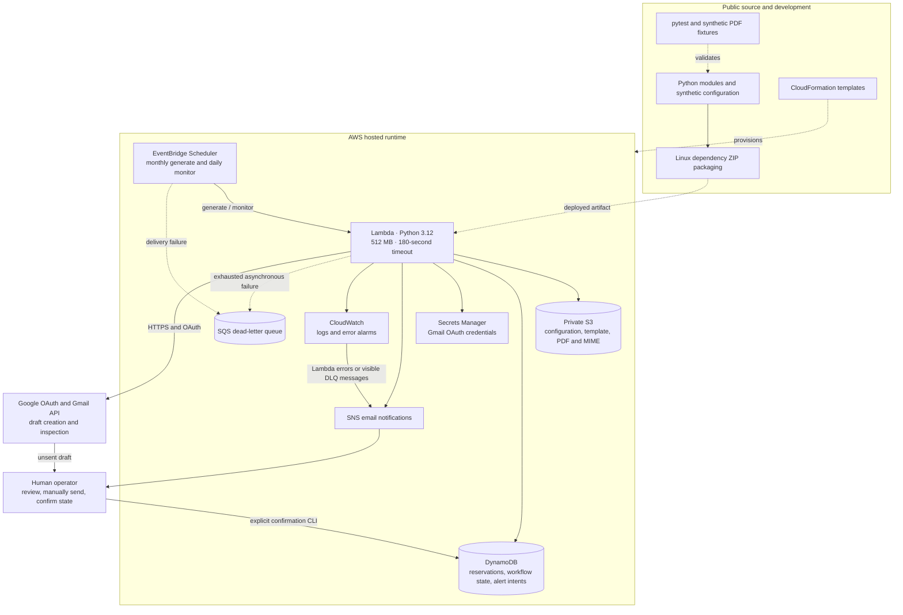
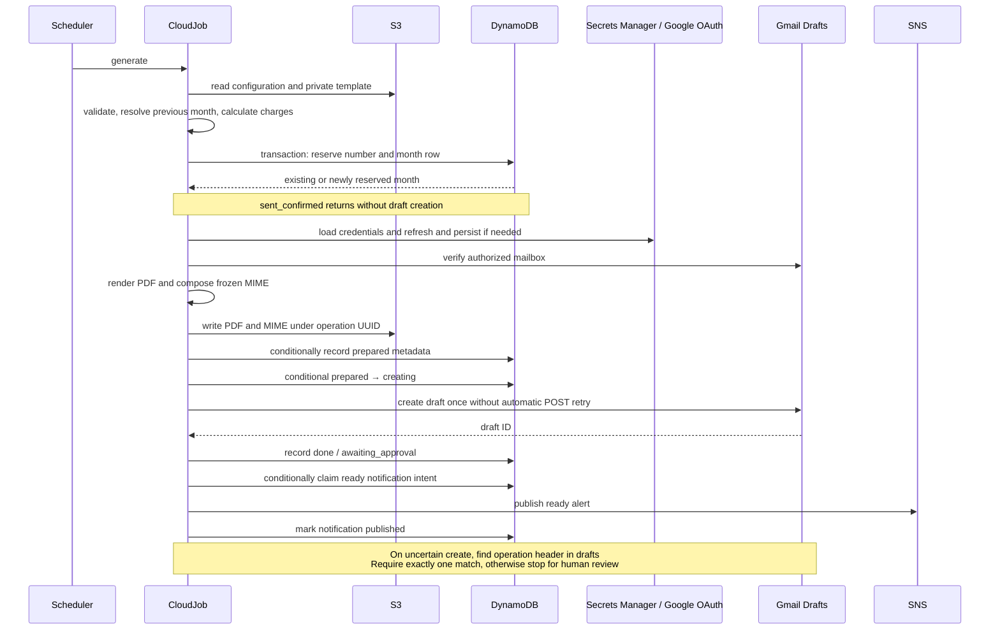
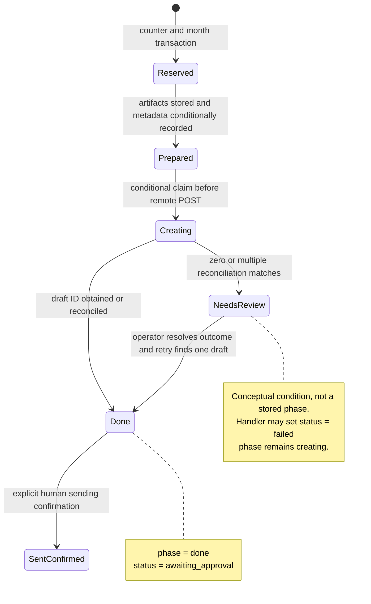
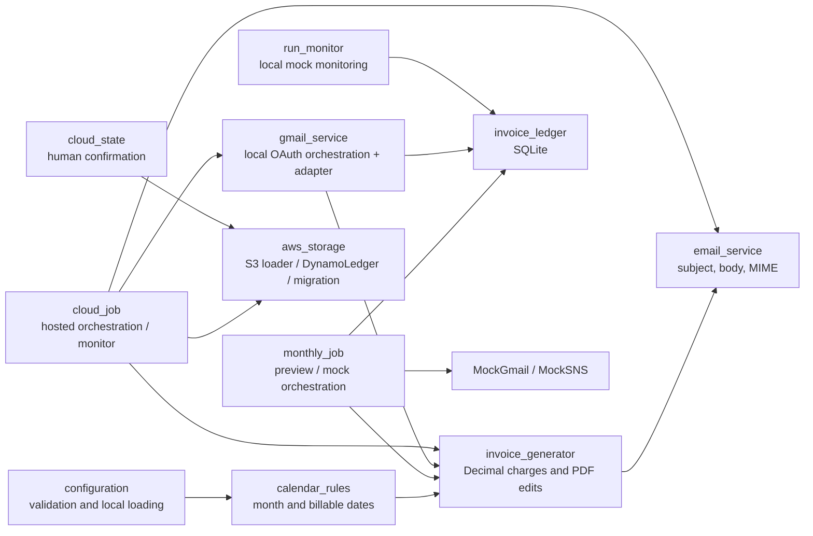

# Casual Services Invoice Automation Platform

## Purpose and evidence boundary

This platform converts a previous calendar month's service dates into a template-based invoice, stores its artifacts, and creates a Gmail draft for human approval. AWS runs the recurring workflow without requiring an operator's computer to be online. The business boundary is deliberate: preparing a draft is automated; issuing it remains a human action.

This document describes the implementation at the October 2026 acceptance milestone. It supports code review and interview discussion; it is not a claim of general-purpose accounting functionality or measured production throughput. Source links are authoritative for behavior. Deployment evidence is summarized in [acceptance testing](ACCEPTANCE_TEST.md); private identifiers and credentials are excluded.

The professional platform name is a documentation name. The existing Python package, CLI names, operation headers, and infrastructure identifiers retain their original names for compatibility. No package migration is implied.

| View | Review question |
|---|---|
| System boundary | What is provisioned, and where does external authority begin? |
| Execution sequence | What happens on a successful run and a retry? |
| State model | Which transitions are atomic, and which are distributed? |
| Domain and modules | Where do billing rules end and infrastructure concerns begin? |
| Security and operations | Which controls exist, and which risks remain? |
| Performance and review backlog | What should be measured or improved next? |

## View 1 — system boundary

The [storage stack](../infrastructure/storage.json) owns retained business data. The [runtime stack](../infrastructure/runtime.json) owns execution, IAM roles, schedules, notifications, alarms, and the dead-letter queue. Runtime replacement therefore need not reset invoice numbering. Retention protects against stack deletion; it is not a complete backup and restore strategy.

Lambda uses outbound service APIs; this template provisions no VPC, NAT gateway, API Gateway, web interface, or application queue between Scheduler and Lambda. SQS is a failure destination, not a normal processing stage. Configured schedules use `Australia/Melbourne`, rather than a fixed UTC offset, to follow daylight saving time.

## View 2 — hosted execution and retry

[`CloudJob.generate`](../src/cleaning_invoice/cloud_job.py) is an orchestration function with several service boundaries, not a transaction spanning AWS and Google. A DynamoDB transaction makes number reservation atomic; S3 uploads, Gmail creation, and SNS publication each commit independently.

The durable `creating` marker is written before the Gmail POST. A second invocation cannot simply issue another POST for that operation. Reconciliation inspects draft MIME headers for the operation UUID. Zero matches can mean the first request never succeeded, is still in flight, or the draft was sent or removed; multiple matches are also ambiguous. The application stops instead of guessing. This favors duplicate prevention over automatic recovery.

Frozen MIME protects retries from newly edited rates, addresses, or template content after preparation. However, the current cloud retry still calculates against the latest configuration before inspecting saved state. A missing new-year calendar or invalid new configuration can therefore block recovery of an already prepared invoice. Input-version pinning is a proposed improvement.

## View 3 — authoritative state and consistency

### Ledger records

| DynamoDB key | Contents and role |
|---|---|
| `counter` | `last_reserved`; monotonic allocation baseline |
| `month#YYYY-MM` | Billing month, reserved number, business status, preparation phase, operation ID, PDF/MIME keys, PDF checksum, dates/totals summary, draft ID, timestamps |
| `event#<event-key>` | Notification claim status and creation timestamp; publication completion marker |

The table has one string partition key and no secondary index. [`DynamoLedger.reserve`](../src/cleaning_invoice/aws_storage.py) performs strongly consistent reads and a conditional transaction updating the counter and inserting the month row. Repeating a month reuses its number. Failed reservations are retained rather than silently recycled. Allocation order follows execution order, not necessarily billing-month order when backfills are involved.

Business `status` and technical `phase` are separate fields. Failure can coexist with a prepared, creating, or done phase. A failed notification can leave a successfully created draft with a failed business status; generation restores awaiting approval for a done row without creating a new draft.

[`cloud_state.confirm_sent`](../src/cleaning_invoice/cloud_state.py) requires a matching invoice number, an existing draft ID, and an awaiting/failed status. It records explicit human evidence. It does not verify delivery in Gmail or provide accounting reconciliation. Draft disappearance is never treated as proof of sending in the hosted workflow.

### Consistency boundaries to review

| Boundary | Current behavior | Remaining failure window |
|---|---|---|
| Counter and month | Conditional DynamoDB transaction | Contention may exhaust 20 attempts; no application backoff |
| Artifacts and prepared row | Uploads precede conditional metadata write | Crash or competing preparation leaves unreferenced objects |
| Creating and Gmail | Claim precedes POST; uncertain outcomes reconcile | Safety can require manual intervention; no cross-service exactly-once transaction |
| Done and human confirmation | Confirmation is conditional; generic job patches are not | A stale concurrent patch can overwrite a later status; needs guarded transitions |
| Alert intent and SNS | Claim before publish, then mark published | Crash before publish can lose alert; successful publish followed by failed state update is ambiguous |

Alert intent deduplication suppresses repeat publication attempts. It does **not** guarantee exactly-once email delivery. The monitor currently does not reconcile unresolved `publishing` events, despite the comment in `notify` suggesting monitoring should surface them. Infrastructure alarms provide a separate route for execution failures, but do not prove every notification reached the operator.

## View 4 — domain rules and module boundaries

Modules separate responsibilities, but the architecture is not a complete ports-and-adapters abstraction. Orchestrators call concrete SQLite methods, DynamoDB expressions, and service adapters directly. `gmail_service.py` combines OAuth setup, a remote adapter, a local state machine, and CLI handling. `aws_storage.py` combines loading, reservation, migration, and CLI handling. These are useful future separation points.

### Calculation contract

For each site and date in the billing month:

1. Establish eligibility from configured working weekdays and the year's non-billable regional public holidays.
2. Apply a global date override when present.
3. Apply a site override instead of the global override when both exist.
4. Count eligible dates, multiply by the site's Decimal daily rate, and round to cents with `ROUND_HALF_UP`.
5. Sum site amounts with Decimal arithmetic.

Leave is represented by a non-billable override with a required reason. An explicit billable override can restore a holiday or weekend. Missing holiday years fail closed. The system uses manually configured holiday data, not a live holiday API. It does not infer statutory entitlement, GST, overtime, hourly attendance, or contract amendments.

The implementation requires exactly two hard-coded site IDs in template order. Email format placeholders also reference these site roles. It is configurable within that contract, not yet a generic multi-customer billing engine.

### PDF and email contract

[`invoice_generator.py`](../src/cleaning_invoice/invoice_generator.py) keeps source page one and replaces five fields: invoice number, issue date, two site amounts, and total. Field discovery uses known source text and character geometry. Labels, static identities, and other source content remain unchanged; static business details belong to the private template. Embedded Arial is reused when available, with Helvetica fallback. Width validation rejects overflowing values. This preserves visual fidelity but couples the renderer to one verified template.

The invoice date is the generation date; the filename and email refer to the billing month. No dedicated dynamic billing-period field is added to the PDF. Email composition attaches a PDF using the standard-library MIME API. The cloud stores serialized MIME before remote creation, enabling replay of the exact attachment.

### Execution modes

| Mode | State authority | External effects | Important distinction |
|---|---|---|---|
| Preview | No reservation | Local PDF, text, JSON | Number is provisional |
| Local mock | SQLite | Local simulated draft and events | Mock monitor can observe simulated sent state |
| Local Gmail | Dedicated SQLite ledger | OAuth and Gmail draft | Explicit reconciliation and deleted-draft recreation CLI |
| Hosted | DynamoDB | S3, Secrets Manager, Gmail, SNS | Local Gmail allocation blocked when AWS mode is configured |

Hosted authority is an operational rule, not a global lock shared by every execution mode. The mock CLI does not enforce the hosted-mode gate. Separate mock ledgers must never be mistaken for issued production state. Cloud draft recreation does not have the local CLI's explicit deleted-draft recovery feature.

## Security and privacy model

| Surface | Implemented control | Practical limit |
|---|---|---|
| Public repository | Synthetic configuration and fixtures; private paths ignored | Ignore rules do not remove prior Git history or prevent accidental forced additions |
| S3 | All public-access blocks, owner-enforced ownership, AES256 default encryption, versioning, TLS deny | SSE-S3, not a customer-managed KMS key; no lifecycle policy |
| Ledger | On-demand capacity, encryption, conditional reservations | No point-in-time recovery enabled in template |
| OAuth | Credentials in Secrets Manager; mailbox preflight; sanitized outer errors | Gmail compose scope permits sending at Google even though the adapter exposes no send method |
| Lambda role | Scoped table, secret, topic, queue, log group, and bucket | S3 permission covers all objects in the chosen bucket, not only production prefixes |
| Scheduler role | Invoke chosen function and send to chosen DLQ; source-account trust condition | No source-ARN restriction in current trust policy |
| Logs and alerts | 14-day logs; error-type failure messages; selected ready payload | Alerts contain billing summaries; configuration is private, but validation is not a security sandbox |

Cloud OAuth refresh writes refreshed credentials back to Secrets Manager. Concurrent invocations can refresh and write independently; there is no credential-refresh lock. Health checks verify mailbox access but may therefore update credentials and are not strictly read-only operations.

The deployed application never calls a send API. That is an application constraint, not a guarantee that the underlying OAuth credential lacks send capability. A compromised credential remains a larger authority than this adapter exposes.

## Operations and observability

Monthly generation is configured for day three at 21:00 Melbourne time. Monitoring runs daily at 21:15, considers the previous month missing or failed from day six, and checks aged pending drafts. Scheduler cron values are literal infrastructure settings; changing JSON schedule preferences alone does not update deployed cron expressions.

Scheduler delivery retries and Lambda asynchronous execution retries are separate layers. Both are configured with one retry and a one-hour event-age limit. Treat execution as potentially repeated; do not assume a single target invocation. A shared DLQ receives delivery and asynchronous failure cases. The template alarms on visible DLQ messages and Lambda errors; it does not provision an automated redrive consumer.

The cloud monitor scans every table page, filters month rows in Python, and checks due drafts through Gmail. A reminder event key prevents repeated SNS publishes, but the monitor still performs draft checks on later days even after the initial reminder has been claimed. It does not automatically confirm sending, resend invoices, generate a missed invoice, or repeat reminder alerts indefinitely.

Operational recovery should inspect the month row, technical phase, stored MIME/PDF, remote drafts, notification intent, and DLQ before retrying. A missing draft requires human review of Sent and explicit state confirmation. Avoid replaying DLQ events without checking ledger state. See [AWS setup](AWS_SETUP.md) and [Gmail setup](GMAIL_SETUP.md) for commands and authorization setup.

## Performance model and measurement plan

There is no latency benchmark, throughput test, or memory profile in the repository. The 512 MB memory setting and 180-second timeout are configuration choices, not demonstrated optimal settings. Monthly volume is small; external round trips and deployment dependency size are more likely to dominate than arithmetic. These are code-based expectations requiring measurement.

| Operation | Scaling / cost driver | Proposed measurement |
|---|---|---|
| Calendar calculation | At most 31 dates per site; O(sites × days) | CPU time under many sites only if generalized |
| PDF editing | Source size, text extraction, font extraction, compression | Duration, peak memory, output size for realistic template variants |
| Generation | S3 reads/writes, ledger calls, OAuth/profile, Gmail POST, SNS | Phase timings and service request counts; cold versus warm runs |
| Monitoring | O(all ledger records), then remote calls for due drafts | ScannedCount, consumed capacity, checked drafts, total duration |
| Reconciliation | List every draft page and fetch raw MIME for every draft | Draft count, transferred bytes, request count, timeout exposure |
| Packaging | Native Linux libraries and broad dependency ranges | ZIP size, initialization duration, repeatable artifact hash |

Monitoring runs much more often than generation, so optimizing it should precede micro-optimizing date loops. At higher volume, query pending invoices through an index rather than scan historical events and confirmed invoices. For this small installation, an index adds complexity and should follow measured need. Safely skipping already completed reminder work can reduce remote calls sooner.

Do not cache mutable configuration or OAuth credentials merely to reduce calls without defining invalidation. First capture S3 version IDs and immutable configuration/template hashes per operation. Consider caching service clients across warm invocations only after timing cold starts and confirming credential lifecycle behavior.

## Developer review backlog

These are observations from static code inspection, not fixes applied by this document. Priorities reflect correctness before tuning.

| Priority | Finding and code evidence | Suggested change and meaningful validation |
|---|---|---|
| High | `CloudJob.patch` writes final statuses without expected-phase/status conditions; handler failure patch uses a previously read row | Guard state transitions, protect sent_confirmed, and test interleavings between confirmation, completion, and failure |
| High | Notification intent may remain publishing; no monitor reconciliation path | Define stale-intent visibility and human recovery; inject failure before publish and after successful publish |
| High | Handler recomputes current previous month on each invocation rather than carrying a scheduled billing period | Define replay semantics across month boundaries; test delayed/redriven events so an old event cannot silently bill a different month |
| Medium | Local loader rejects duplicate JSON keys; S3 loader uses ordinary `json.loads` | Share parsing and validation; test duplicate keys identically in both paths |
| Medium | Local monitor honors missed_run_detection; cloud monitor does not; cloud exception path does not honor failure notification flag | Define and test one notification policy shared across modes |
| Medium | Generation calculates current config before checking prepared state; no input version IDs recorded | Pin immutable inputs and use saved artifacts for recovery; test config/calendar changes during retry |
| Medium | Monitor performs full scan and repeated due-draft checks despite claimed reminder | Skip completed reminder work safely; add paginated and growing-ledger tests before introducing an index |
| Medium | Broad transaction-cancellation retry, 20 attempts without backoff in DynamoLedger | Classify retryable causes and add bounded jitter; test contention and non-retryable transaction failures |
| Medium | PDF source markers and two site IDs are fixed; invoice number confirmation check differs between local and cloud paths | Make template/site contract explicit and enforce baseline policy consistently; test malformed/new templates |
| Medium | Migration commits ledger before uploading private inputs; cross-service rollback is absent | Record migration stages and offer resumable verification without resetting reservations; inject failure at each boundary |
| Medium | Competing preparation uploads independent objects before metadata claim | Record orphan provenance and define lifecycle/cleanup rules that preserve issued evidence |
| Medium | DynamoDB PITR and S3 noncurrent-version lifecycle are absent | Define recovery objectives and retention, then validate restore using synthetic data |
| Low | Decimal/config validation and dictionary access can surface inconsistent errors for malformed shape | Introduce typed validated domain objects and stable validation errors if configuration grows |

### Duplication and refactoring boundaries

`monthly_job.run`, `gmail_service.draft_invoice`, and `CloudJob.generate` repeat billing-period selection, calculation, naming, PDF/MIME assembly, summaries, and ready-message construction. Local and cloud monitors repeat missed-run and reminder rules but already differ in flag handling. Local and cloud OAuth paths also repeat credential loading, refresh, build, and mailbox validation.

A reasonable incremental refactor is an immutable invoice preparation result containing billing period, charges, artifact bytes, checksum, and operation metadata; shared monitoring decisions operating on normalized records; and explicit repository/remote adapter contracts. Keep SQLite transactions and DynamoDB conditional writes in separate persistence implementations: sharing domain behavior must not erase their different consistency mechanisms.

Avoid a generic orchestration framework before these contracts are clear. Begin with parity tests for rules that should be identical, then extract those rules. Use fault-injection and concurrency tests to protect the remote-create boundary, rather than tests that merely mirror SQL or expression strings.

## Verification and limits

At the acceptance milestone, 53 offline pytest tests passed. Coverage includes regional calendars, overrides, timezone rollover, currency, configuration rejection, PDF visual preservation, local numbering concurrency, Gmail uncertainty/recreation, cloud retry behavior, explicit sending confirmation, and acceptance isolation. Fake DynamoDB tests inspect selected expressions and simulate selected transitions; they are not proof of all real concurrent executions. There is no coverage percentage or performance result claimed here.

An isolated one-time AWS schedule used a separate ledger and synthetic template, created a labelled Gmail draft, verified its attachment against stored S3 bytes/checksum, published a ready alert, and reused the same draft on retry. The user confirmed receiving the test draft. Temporary test compute/state resources were removed; production numbering was unchanged. This verifies the exercised path, not every failure window. The first recurring production monthly run remained upcoming at this milestone.

## Implemented versus proposed

| Implemented | Proposed / not implemented |
|---|---|
| Regional date calculations and leave overrides | Live holiday synchronization and contract entitlement engine |
| Two-site template-preserving PDF and frozen MIME | Generic templates, arbitrary sites, GST/accounting engine |
| Conditional numbering and durable remote-create intent | Distributed exactly-once transaction or automatic ambiguity resolution |
| Gmail draft-only application adapter | Automatic sending or automated Sent evidence verification |
| Scheduled Lambda, SNS, DLQ, error alarms | Automated DLQ redrive, dashboard, detailed phase metrics |
| Private S3, Secrets Manager, encrypted DynamoDB | Customer-managed S3 KMS key, PITR/restore drills, private networking |
| Manual Linux ZIP packaging and CloudFormation | Automated CI/CD, dependency lockfile, immutable release promotion |
| Synthetic acceptance isolation | Load tests, memory profiling, complete cloud concurrency fault matrix |

For an interview, the defensible design discussion is the tradeoff between unattended preparation and controlled issuance, atomic local reservations versus distributed side effects, frozen artifacts versus mutable configuration, and low-volume simplicity versus future monitoring scale. Describe these controls together with their remaining failure windows rather than claiming universal exactly-once delivery or an optimized high-throughput platform.
